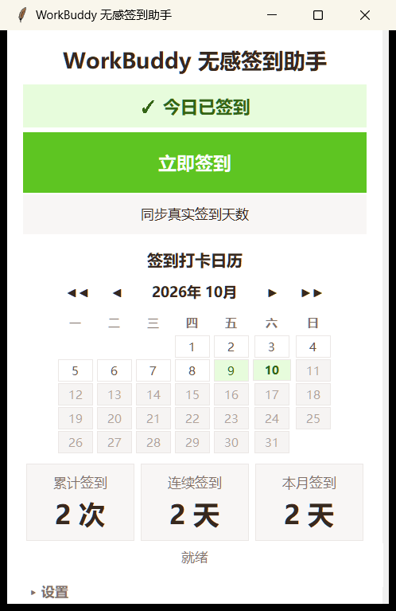

# WorkBuddy 无感签到助手

> 一键或定时自动完成 WorkBuddy 签到：UIA 直驱控件，全程不碰鼠标。



## 这是什么

WorkBuddy 用户每天要手动签到领积分，繁琐又易忘，错过即损失积分。

本工具是一个 Windows 桌面程序，把签到彻底自动化：开机启动自运行，或设定每日定时任务，程序自动完成全部步骤——**成功静默结束、失败才提醒**。全程不移动鼠标、不模拟点击，签到时你可以继续做自己的事。

## 功能特性

- 🖱️ **全程不碰鼠标** — 通过 Windows UI Automation 直接触发界面控件，鼠标纹丝不动，不抢占输入焦点
- 📅 **签到打卡日历** — 按月查看签到记录，支持年月切换
- 📊 **统计面板** — 累计签到 / 连续签到 / 本月签到，一目了然
- ⏰ **每日定时自动签到** — Windows 计划任务驱动，到点自动签，电脑开着即可无人值守
- 🔄 **同步真实签到天数** — 自动读取 Buddy 加油站「已领 N 天」数据，校准统计
- ✏️ **手动补签** — 点选日历上的日期，补录历史签到
- 💾 **数据本地持久化** — JSON 存储，数据不出电脑
- 🫥 **托盘常驻** — 最小化到托盘，不占任务栏

## 技术实现

核心思路：**不用坐标点击，不模拟鼠标**。WorkBuddy 是 Electron 应用，其界面元素通过 Windows UI Automation（UIA）以控件树形式暴露。程序遍历 accessibility 树，按名称精确定位「Buddy 加油站」「立即领取」等按钮，调用 `InvokePattern.Invoke()` 直接触发——这是系统级的无障碍接口，等价于键盘激活控件，鼠标光标全程静止。

| 模块 | 技术方案 |
|------|---------|
| 无鼠标触发 | UIA COM 接口（`uiautomation` 库），`GetInvokePattern().Invoke()` 直驱按钮 |
| 控件定位 | 遍历 Electron accessibility 树，按 Name / ControlType 匹配 |
| 环境隔离 | 独立子进程执行 UIA 签到，退出码回传结果，规避 COM 与 GUI 主循环冲突 |
| 窗口恢复 | 检测最小化窗口并 `ShowWindow` 还原，保证控件可访问 |
| 定时任务 | Windows 计划任务（`schtasks`），到点执行 `--auto` 静默签到 |
| 数据持久化 | 本地 JSON 记录每日签到，统计累计 / 连续 / 本月 |
| 真实数据同步 | UIA 读取加油站页面「已领 N 天 / 累计 M 分」校准统计 |
| 图形界面 | Tkinter，自定义设计令牌（配色 / 字号 / 间距），可滚动容器 |

## 快速开始

### 方式一：下载可执行文件（推荐）

前往 [Releases](../../releases) 页面下载最新版，双击即用。

> 系统要求：Windows 10 / 11，本机已安装并登录 WorkBuddy 桌面客户端。

### 方式二：从源码运行

```bash
pip install -r requirements.txt
python main.py
```

需要 Python 3.10+，依赖 `uiautomation`、`pystray`、`Pillow`。

### 从源码打包

```bash
pip install pyinstaller
pyinstaller --noconfirm --clean "WorkBuddy自动签到.spec" --collect-submodules comtypes.gen
```

## 使用说明

1. **立即签到**：启动程序，点击绿色主按钮——程序自动打开 WorkBuddy 完成签到，全程鼠标不动
2. **定时自动签到**：展开「设置」→ 勾选「每日定时自动签到」并设定时间（如 21:00），之后每天到点自动签
3. **补签与同步**：直接点击日历上的日期补录历史签到；点「同步真实签到天数」把统计校准成加油站的真实数据

## 合规说明

本工具模拟的是**用户本人**对自己账号的合法签到操作：不绕过任何验证、不访问他人账号、不违规刷取，签到结果与手动签到完全一致。

---

*本作品参加「重庆大学 AI 开学季 · 校园智能体创新挑战赛」。*
